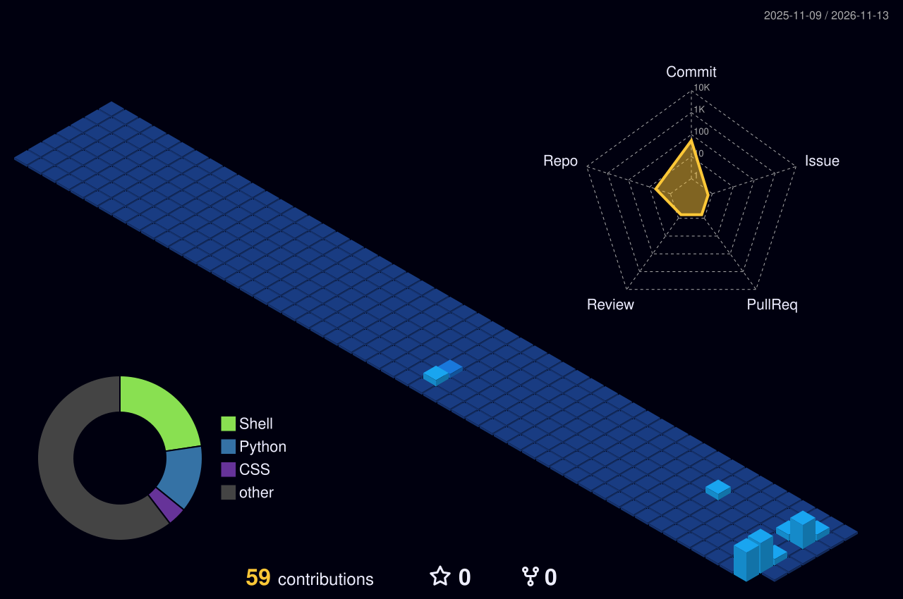

<picture>
  <source media="(prefers-color-scheme: light)" srcset="light/banner-light.svg?v=1"/>
  
</picture>

<picture>
  

</picture>

 
<picture>

</picture>

Ingeniera Mecatrónica con experiencia en desarrollo front-end (Angular, Ionic), en transición hacia **ciberseguridad y operaciones SOC**.
Me estoy formando con programas de Cisco y Microsoft para trabajar en el área de Ciberseguridad.
 
 

<picture>

</picture>

<picture><source media="(prefers-color-scheme: light)" srcset="light/stack-light.svg?v=1"/></picture>

 
 

<picture>

</picture>

<picture><source media="(prefers-color-scheme: light)" srcset="light/progreso-light.svg?v=1"/></picture>
 
 

<picture>

</picture>

<picture><source media="(prefers-color-scheme: light)" srcset="light/insignias-light.svg?v=1"/></picture>
 
 

<picture>

</picture>

Haz clic en una tarjeta para ver el proyecto en detalle.

 
<!--
<a href="https://github.com/deni-0/soc-labs/tree/main/01-Networking"><picture><source media="(prefers-color-scheme: light)" srcset="proj-1-light.svg?v=1"/></picture></a>
<a href="https://github.com/deni-0/soc-labs/tree/main/02-Linux-Windows"><picture><source media="(prefers-color-scheme: light)" srcset="proj-2-light.svg?v=1"/></picture></a>
-->
<a href="https://github.com/Deni-0295/cybersecurity-portfolio/tree/main/03-SOC-Labs"><picture><source media="(prefers-color-scheme: light)" srcset="light/labs/proj-3-light.svg?v=1"/></picture></a>
<!--
<a href="https://github.com/deni-0/soc-labs/tree/main/04-SIEM"><picture><source media="(prefers-color-scheme: light)" srcset="proj-4-light.svg?v=1"/></picture></a>
<a href="https://github.com/deni-0/soc-labs/tree/main/05-Detection-Rules"><picture><source media="(prefers-color-scheme: light)" srcset="proj-5-light.svg?v=1"/></picture></a>
<a href="https://github.com/deni-0/soc-labs/tree/main/06-Threat-Intelligence"><picture><source media="(prefers-color-scheme: light)" srcset="proj-6-light.svg?v=1"/></picture></a>
<a href="https://github.com/deni-0/soc-labs/tree/main/07-Incident-Reports"><picture><source media="(prefers-color-scheme: light)" srcset="proj-7-light.svg?v=1"/></picture></a>
<a href="https://github.com/deni-0/soc-labs/tree/main/08-Scripts"><picture><source media="(prefers-color-scheme: light)" srcset="proj-8-light.svg?v=1"/></picture></a>
<a href="https://github.com/deni-0/soc-labs/tree/main/09-MITRE-ATT%26CK"><picture><source media="(prefers-color-scheme: light)" srcset="proj-9-light.svg?v=1"/></picture></a>
<a href="https://github.com/deni-0/soc-labs/tree/main/10-Vulnerability-Analysis"><picture><source media="(prefers-color-scheme: light)" srcset="proj-10-light.svg?v=1"/></picture></a>
-->
<a href="https://github.com/Deni-0295/laboratorios-microsoft"><picture><source media="(prefers-color-scheme: light)" srcset="light/proyectos/proj-2-light.svg?v=1"/></picture></a>
<a href="https://github.com/Deni-0295?tab=repositories"><picture><source media="(prefers-color-scheme: light)" srcset="light/proyectos/proj-6-light.svg?v=1"/></picture></a>

 
 

<picture>

</picture>

<picture><source media="(prefers-color-scheme: light)" srcset="light/id-dashboard-light.svg?v=1"/></picture>
 
 

<picture>

<picture>

<picture>
  <source media="(prefers-color-scheme: dark)" srcset="https://raw.githubusercontent.com/Deni-0295/Deni-0295/output/github-contribution-grid-snake-dark.svg"/>
  <source media="(prefers-color-scheme: light)" srcset="https://raw.githubusercontent.com/Deni-0295/Deni-0295/output/github-contribution-grid-snake.svg"/>
  
</picture>
 
 

<picture>

<picture>

<picture>
  <source media="(prefers-color-scheme: light)" srcset="https://raw.githubusercontent.com/Deni-0295/Deni-0295/3d-output/profile-green-animate.svg"/>
  
</picture>
 
 

<picture>

</picture>

    <picture><source media="(prefers-color-scheme: light)" srcset="light/sobre-mi-light.svg?v=1"/></picture>
<picture><source media="(prefers-color-scheme: light)" srcset="light/ahora-light.svg?v=1"/></picture>

 
 

<picture>

</picture>
<picture><source media="(prefers-color-scheme: light)" srcset="light/connect-light.svg?v=1"/></picture>
<a href="https://github.com/Deni-0295"><picture><source media="(prefers-color-scheme: light)" srcset="light/connect-github-light.svg?v=1"/></picture></a>
<a href="https://www.linkedin.com/in/irma-suarez/"><picture><source media="(prefers-color-scheme: light)" srcset="light/connect-linkedin-light.svg?v=1"/></picture></a>
<a href="mailto:dens42514@gmail.com"><picture><source media="(prefers-color-scheme: light)" srcset="light/connect-correo-light.svg?v=1"/></picture></a>
<a href="https://tryhackme.com/p/Deni0295"><picture><source media="(prefers-color-scheme: light)" srcset="light/connect-tryhackme-light.svg?v=1"/></picture></a>

