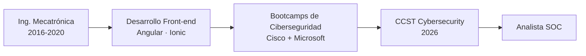

<!-- HERO -->

# Irma

### Ingeniera Mecatrónica · Desarrolladora Front-end · En transición a Ciberseguridad (SOC)

*Del código y los sistemas a la defensa: aprendiendo a detectar, analizar y responder ante amenazas.*

---

## 🚀 Sobre mí

- 🎓 **Ingeniera Mecatrónica** (Universidad de Guanajuato, 2016–2020), con título y cédula profesional.
- 💻 Experiencia como **Desarrolladora Front-end** (Angular, Ionic) en NeixtMedia y como freelance.
- 🔐 Actualmente en **transición hacia Ciberseguridad**, con meta de **Analista SOC (Nivel 1/2)**.
- 🛡️ Certificada en **Cisco CCST Cybersecurity (2026)**.
- 🧪 Practico con **laboratorios** en redes, seguridad de terminales y seguridad en la nube.
- 📍 León, Guanajuato, México.

> *Mi formación en ingeniería y mi experiencia desarrollando aplicaciones me permiten entender los sistemas desde adentro, y eso ayuda a defenderlos.*

---

## 🎯 Ruta de formación en Ciberseguridad

### 🔷 Bootcamp 1: Fundamentos de la Ciberseguridad (Cisco)
*Mujer Digital · Junior Achievement Américas* → **Certificación CCST Cybersecurity**

| Módulo | Tema |
|:--:|:--|
| 1 | Introducción a la ciberseguridad |
| 2 | Conceptos básicos de red |
| 3 | Dispositivos de red y configuración inicial |
| 4 | Seguridad de terminales |
| 5 | Defensa de la red |
| 6 | Administración de amenazas cibernéticas |

### 🟦 Bootcamp 2: Fundamentos de Ciberseguridad con tecnologías Microsoft
*INFOTEC · Centro Público de Formación en Inteligencia Artificial*

| Ruta | Enfoque |
|:--|:--|
| ☁️ [Microsoft Azure Fundamentals (AZ-900)](https://learn.microsoft.com/es-es/credentials/certifications/azure-fundamentals/) | Conceptos de nube, servicios de Azure, gobierno y costos |
| 🔑 [Security, Compliance, and Identity Fundamentals (SC-900)](https://learn.microsoft.com/es-es/credentials/certifications/security-compliance-and-identity-fundamentals/) | Seguridad, cumplimiento, identidad y protección de amenazas |

> 📌 Ambos bootcamps incluyen **laboratorios prácticos** que documento en mis repositorios.

---

## 🧰 Tech Stack

### 🔐 Ciberseguridad (en desarrollo)

`Seguridad de terminales` · `Defensa de la red` · `Gestión de amenazas` · `Conceptos de redes` · `Identidad y acceso` · `Cumplimiento` · `Fundamentos de SOC`

### 💻 Desarrollo Front-end (mi base)

### 🛠️ Herramientas

---

## 🧪 Laboratorios y proyectos

> Agrega aquí enlaces a tus repositorios reales. Ejemplos de estructura:

| Proyecto | Descripción | Tecnologías |
|:--|:--|:--|
| 🔬 **Lab: Configuración inicial de dispositivos de red** | Configuración y aseguramiento básico de dispositivos | Cisco Packet Tracer |
| 🔬 **Lab: Seguridad de terminales** | Hardening y protección de equipos | Windows / Linux |
| ☁️ **Lab: Fundamentos de Azure** | Recursos, identidad y seguridad en la nube | Microsoft Azure |
| 🔑 **Lab: Identidad y acceso** | Conceptos de Microsoft Entra ID y protección de amenazas | Microsoft Security |
| 📝 **Notas de estudio CCST** | Resúmenes y simulacros por módulo | Markdown / HTML |

---

## 🗺️ Mi camino

---

## 🎓 En qué estoy trabajando ahora

- ✅ Reforzando fundamentos de redes y seguridad con laboratorios.
- ✅ Completando las rutas AZ-900 y SC-900.
- 🔜 Practicar análisis de logs, detección de incidentes y herramientas SIEM.
- 🔜 Construir un portafolio público de laboratorios documentados.

---

💬 ¿Buscas a alguien con base técnica sólida y enfoque en seguridad? **¡Hablemos!**

